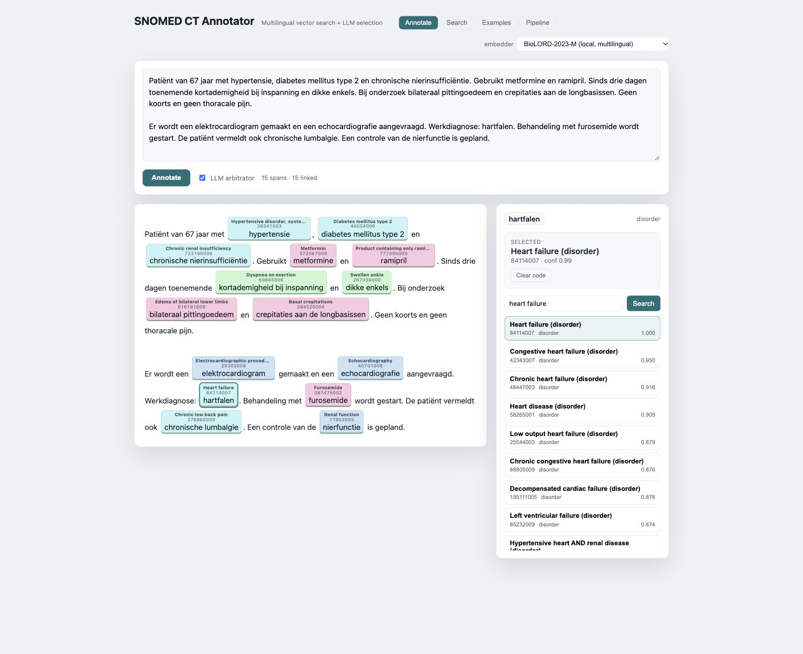
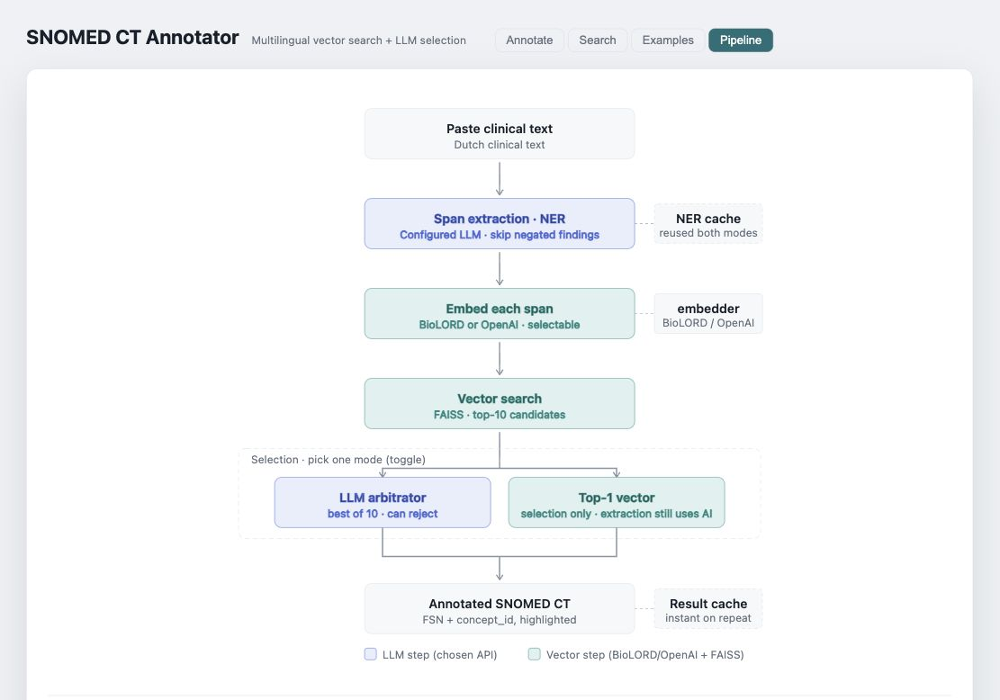

# SNOMED CT Annotator

**Van klinische tekst naar aanklikbare SNOMED CT-codes.** Dit prototype helpt
zorgverleners en terminologieteams om vrije Nederlandstalige tekst te structureren
en voorgestelde codes te controleren.

- **Annoteren:** medische begrippen worden gemarkeerd met hun SNOMED CT-code.
- **Controleren:** klik op een begrip, bekijk alternatieven en pas de code aan.
- **Zoeken:** zoek rechtstreeks in SNOMED CT, ook met Nederlandse termen.
- **Inzicht:** bekijk de verwerkingsstappen en gebruikte AI-instructies.

### Geannoteerde tekst

Fictief voorbeeld met voorgeschiedenis, medicatie, klachten, onderzoeken en een
behandelplan. De tekst blijft leesbaar; rechts staan de gekozen code en alternatieven.



### Hoe werkt het?

Een taalmodel herkent medische begrippen, een lokale zoekindex vindt passende
SNOMED CT-concepten en een optionele AI-stap kiest de beste kandidaat in de
context. De gebruiker kan die keuze controleren en aanpassen.



### Kies zelf de LLM-API

**OpenAI is de standaard, maar geen verplichting.** Je kunt ook een
**OpenAI-compatibele API** of de **Anthropic Messages-API** instellen. Een eigen
LLM-server binnen de instelling kan via een compatibel endpoint worden aangesloten.
Provider, model, API-adres en sleutel stel je in via één configuratiebestand.
BioLORD-zoeken blijft lokaal en staat los van die keuze.
[Voorbeelden en ondersteunde API-formaten →](docs/llm-providers.md)

### Binnen de zorginstelling installeren

De IT-dienst heeft Docker met Compose, een geldige **SNOMED CT International
RF2-release** en toegang tot de gekozen LLM-API nodig. De standaard webapp en
BioLORD-zoekindex hebben geen GPU of aparte terminologieserver nodig. Een zelf
gehost taalmodel heeft eigen hardwarevereisten.

```bash
git clone https://github.com/stighellemans/snomed-annotator.git
cd snomed-annotator
cp backend/.env.example backend/.env
# Vul de LLM-instellingen in en plaats één RF2-zip in snomed/.
python3 scripts/setup.py
```

Het script controleert de vereisten, test de LLM-API met fictieve testinvoer,
bouwt een ontbrekende BioLORD-index en start de app op **http://localhost:5180**.
Een bestaande index blijft bewaard. De eerste indexopbouw kan lang duren;
latere starts hergebruiken die index.
[Installatie en beheer →](docs/installation.md)

**Voor een pilot:** de tekst gaat naar de ingestelde LLM-API, ook als de optionele
AI-codekeuze uitstaat. Met een lokaal taalmodel en BioLORD kan die verwerking
binnen de instelling blijven. Het prototype is niet klinisch gevalideerd;
correcties blijven alleen in het huidige scherm. Er is nog geen EPD-koppeling
of gebruikersbeheer.
